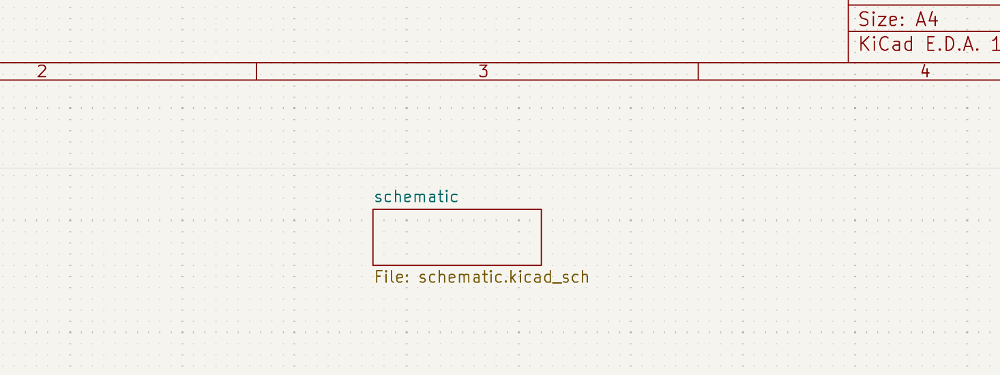
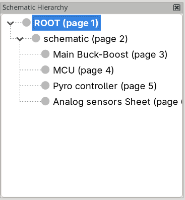
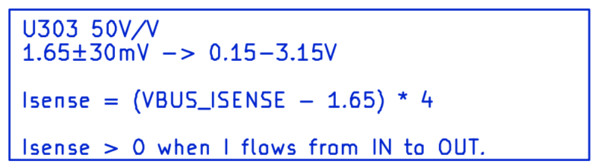
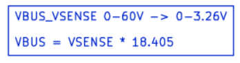
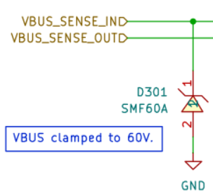
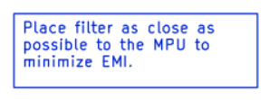

# PCB Design & Review Guidelines – Thrust Team

## 1. Overview & Objective

The primary objective of this guide is to establish a standardized hardware design workflow for the **Thrust** student team. This guide assume knowledge of KiCad software. Following these guidelines ensures that every PCB designed for our rockets and ground support systems is well-documented and **easy and fast to review**.

By adhering to this workflow, team members ensure that design choices are clearly justified, errors are minimized early in the development cycle, and production files can be reviewed and approved swiftly by the Electronics Lead.

## 2. Project Setup & Repository Structure

To maintain consistency across all projects, every new board must strictly follow the repository template and directory conventions outlined below.

### 2.1 Repository Setup

1. **Create Folder:**
   * Create a new folder under the PCB folder.
   * Repository naming convention: `<rocket_name>_board_<board_short_code>` (e.g., 'sfr3_board_kardia`, `sfr3_board_payload_telemetry`).

2. **Git Configuration & `.gitignore`:**
   * Include a KiCad-specific `.gitignore` file to prevent committing local backup files, autosaves, cache files, and build outputs.
   * Key files that **MUST** be committed: `.kicad_pro`, `.kicad_sch`, `.kicad_pcb`, project footprint/symbol libraries, and manual documentation sources.
   * Key files/folders that **MUST NOT** be committed to main branch source control directly: KiCad auto-generated backup files (`*-bak`), `.kicad_prl` local user preferences, and temporary execution outputs.

3. **.gitignore changes:**
   * if usign DrawIo for block diagram drawign include

### 2.2 Directory Structure

Every board project folder must be organized as follows:

```
<rocket_name>_board_<board_short_code>/
├── docs/                                   # Documentation, PDR notes
│   ├── datasheets/                         # Datasheets of the board components
│   ├── renders/                            # Renders and step of the board
│   ├── <board_name>_spec.md                # Design choices and requirements
│   ├── <board_name>_schematics.pdf         # Schematic plot
│   ├── <board_name>_assembly.pdf           # Assembly plot
│   ├── <board_name>_block_diagram.drawio   # Schematic plot
│   └── <board_name>_block_diagram.pdf      # Assembly plot
├── hardware/                               # KiCad project files
│   ├── <board_name>.kicad_pro              # KiCad Project File
│   ├── <board_name>.kicad_sch              # Root Schematic Sheet
│   ├── <board_name>.kicad_pcb              # PCB Layout File
│   └── libs/                               # Custom components for this board
├── manufacturing/                          # Production & Assembly outputs
└── README.md                               # Project overview, test instructions
```

## 3. Pre-Design Phase (Architecture & Requirements)

Overall board architecture and specifications must be documented during the preliminary design phase and first shematic drawing.
Then it should be frozen until the finished design.

### 3.1 Design Justification Document

Every board repository must contain an architecture summary document located in `docs/<board_name>_spec.md`. This file explain the board design and iteration.

The document must clearly outline:
* **System Context & Purpose:** High-level overview of where the board fits in the rocket/ground systems.
* **Power Architecture:** Input voltages, expected peak/nominal current draw, power domains, and regulator choices.
* **Key Components Selection:** Microcontrollers, sensors, power switches, and communication transceivers, along with justifications for selecting specific part numbers.
* **Interface & Connector Specs:** Pinout mappings for external buses (CAN, SPI, UART, power rails, connectors).
* **Thermal & Mechanical Constraints:** Enclosure size limitations, mounting hole locations, keep-out zones, and expected heat dissipation.

> **Note:** A guide on how to design a board is provided in a separate Thrust procedure document. TBD

## 4. Schematic Capture Guidelines (KiCad)

The schematic is the foundation of the entire board. To keep it readable and structured for fast code/design reviews, follow these layout rules and organizational principles.

### 4.1 Hierarchical Sheets Structure

* **Root Sheet as Block Diagram:** The root sheet (`.kicad_sch`) must act as a high-level block diagram representing the board's sub-systems. Avoid placing discrete components or dense wiring on the root sheet whenever possible. Place a single hierarchical sheet named `schematic` out off the drawing sheet. 
* **Functional Decomposition:** Use hierarchical sub-sheets for distinct functional blocks (e.g., `Power_Supply.kicad_sch`, `Microcontroller.kicad_sch`, `CAN_Bus.kicad_sch`, `Sensors.kicad_sch`).
* **Clear Labeling:** Explicitly name all hierarchical pins and buses. Standardize bus signal names across all sheets.



### 4.2 Net Naming & Power Symbols

* **Explicit Net Names:** Never leave critical nets with KiCad default auto-generated names (e.g., `Net-(R1-Pad1)`). Name all power rails, communication lines (TX/RX, SDA/SCL, MOSI/MISO), and control signals explicitly. For easier groupping `Rule Areas` can be used.
* **Group Net by Color:** Net of the same group must be add togheter in "Net Classes" menù of KiCad. Every group must have a net color for easy net identification.
* **Power Flags & Symbols:** Use standard power symbols (`+3V3`, `+5V`, `GND`) consistently across all sheets. Ensure power sources use proper `PWR_FLAG` notation where needed to satisfy ERC without suppressing real warnings.

### 4.3 Schematic Annotations & In-Line Documentation

To make the schematic easy to review without opening external documents:
* **Block Text Notes:** Place text boxes next to critical functional blocks detailing default jumper settings, I2C address tables, pin mapping constraints, or special power-sequencing requirements.


* **Connector Pinouts & Warning Labels:** Clearly indicate connector pin assignments, maximum allowed input voltages, and polarity flags directly beside each connector symbol.

* **PCB Guidelines Text Box:** Add a dedicated text box on the relevant schematic sub-sheet containing notes for the PCB layout phase (e.g., *"Place bypass capacitor C10 as close as possible to Pin 5"*, *"Keep high-current trace > 1.5mm wide"*).
  


### 4.4 Custom Libraries Management

To guarantee long-term project reproducibility and prevent broken symbol links:
* All non-standard symbols or modified footprints **MUST** be saved inside the project's embedded library folder (`hardware/libs/`).
* Do **NOT** link symbols or footprints to personal local paths on your computer.
* Datasheet should be saved into `docs/datasheets` folder and connected to the symbol.

### 4.5 BOM Management

To streamline component sourcing and PCB assembly:
- **Fields Standardization:** Ensure every schematic symbol includes mandatory fields: 
  - `Value`;
  - `Footprint`;
  - `Datasheet`;
  - `Description`;
  - `Manufacturer_Name`;
  - `Manufacturer_Part_Number`;
  - `Mouser_Link` (if applicable);
  - `Digikey_Link` (if applicable);
  - `LCSC` (if applicable);
- **Exporting BOM:** Use standard KiCad BOM generation tools to produce a clean CSV file saved into the `manufacturing/` directory.

### 4.6 Electrical Rules Check (ERC)

* Run KiCad's Electrical Rules Check (ERC) prior to committing your schematic.
* The committed schematic **MUST** pass ERC with **0 Errors** and **0 Warnings**.
* If a warning is intentionally ignored (e.g., unconnected pin on purpose), it must be explicitly marked as excluded with a documented reason in KiCad.

## 5. PCB Layout & Routing Guidelines

A well-routed PCB simplifies debugging and ensures signal integrity.

### 5.1 Board Silkscreen & Marking Requirements

Every board **MUST** include clear, legible text on the top or bottom silkscreen containing the following mandatory details:

* **Board Name & Code:** Matching the repository identifier (e.g., `SFR3 - Kardia Board`).
* **Hardware Version & Date:** Semantic versioning and release date (e.g., `v1.0 - DD/MM/YYYY`).
* **Author / Designer:** Name/GitHub username of the primary designer(s).
* **Branding & Logos:** Official **Thrust** logo and sponsor logos (if applicable).
* **Connector & Pin Labels:** Every pin header, terminal block, jumper, and debug pin **MUST** have an explicit silkscreen label indicating its pin name/function and signal direction.
* **Status LEDs:** Indicate LED function (e.g., `PWR`, `LINK`, `DEBUG`).

### 5.2 Mechanical Constraints & Placement

* **Keep-Out & Mounting Holes:** Maintain a minimum clearances of 3mm around all mounting holes and physical board edges (no traces or components within this perimeter).
* **3D Step Validation:** Export the full board 3D step model into `docs/renders/` and verify physical clearances before finalizing routing.
* **Accessibility:** Place debug connectors, testpoints, status LEDs, programming headers, and manual reset buttons along the board edges or easily accessible locations.
* **Pannelization:** Any pannelization should be added in the cad if required and not be added by the PCB manufacturer.

### 5.3 Stackup & Design Rules Check (DRC)

* **Stackup:** Choose the right stackup for the board and layer thickness according to manufacturer capabilities.
* **Manufacturer Capabilities:** Set KiCad's Board Setup design rules strictly according to our PCB manufacturer's minimum capabilities (e.g., minimum trace width/spacing, minimum drill size, clearance to edge), capabilities can be found on manufacturer website.
* **Power & Ground Planes:** Use dedicated copper fills / planes for ground (`GND`) to minimize noise and improve thermal dissipation.
* **Clean DRC Run:** The layout **MUST** yield **0 Errors** and **0 Warnings** under KiCad's Design Rules Check (DRC).

## 6. Manufacturing Files Generation (CAM)

Before submitting the board for review and production, all required manufacturing artifacts must be generated, checked, and saved under the `manufacturing/` directory.

### 6.1 Manufacturing note file

Into `manufacturing/` folder **must** be createde a file named `manufacturing_notes` containign notes for the manufacturing of the board:

 - Board dimension: width, height.
 - Board type: layer, material, thickness.
 - External copper thickness.
 - Surface finish.
 - Solder mask.
 - Silkscreen.
  
add also "Accept manufacturer standard tolerances unless otherwise specified" at the end of the file.

### 6.2 Gerber & NC Drill Files

* **Format:** Export standard RS-274X Gerber files and XLNC Drill files into `manufacturing/gerber/` and package them into a `<rocket_name>_board_<board_short_code>.zip` file.
* **ODB++ (Preferred):** If supported by the manufacturer, generate ODB++ output as a single unified manufacturing archive.

### 6.3 Assembly & Position Files (CPL / POS)

* **Position / Pick & Place File:** Export the Position file (`.csv` or `.pos`) with `mm` units and ASCII encoding into `manufacturing/pos/`.

### 6.4 Assembly Drawings & Visual Validation

* Export printable PDF plots of the Top and Bottom Assembly layers into `docs/<board_name>_assembly.pdf`.
* Ensure component designators (RefDes), polarities (diodes, electrolytic capacitors, ICs) and board measurements are clearly legible.

## 7. Design Review & GitHub Pull Request Workflow

To ensure fast and efficient approval, all design updates and new boards must follow the standard GitHub Pull Request (PR) workflow.

### 7.1 Preparing the Pull Request

1. **Self-Review Checklist:** Before requesting a review, verify that:
   - [ ] ERC passes with **0 Errors / 0 Warnings**.
   - [ ] DRC passes with **0 Errors / 0 Warnings**.
   - [ ] Silkscreen details (board name, version, date, pinout labels, logos) are complete.
   - [ ] `docs/<board_name>_spec.md` is updated and reflects all current design decisions.
   - [ ] Updated PDFs (`<board_name>_schematics.pdf` and `<board_name>_assembly.pdf`) are generated and placed in `docs/`.
   - [ ] 3D STEP/render files are updated in `docs/renders/`.

2. **Opening the PR:**
   * Open a Pull Request from your feature branch into `main`.
   * **PR Title Format:** `[Board Review] <board_short_code> - v<version>` (e.g., `[Board Review] kardia - v1.0`).
   * **PR Description:** Include a summary of changes, links to the architecture spec, and embedded 3D renders or schematic screenshots for quick visual inspection without opening KiCad.

### 7.2 Review & Approval Process

* The Electronics Lead will review the PR using the documentation, `docs/<board_name>_spec.md`, schematic PDF, and KiCad source files.
* Inline feedback or requested changes will be discussed directly on the GitHub PR line comments.
* Once all checks and review comments are resolved, the Lead will approve the PR and authorize production file generation.

## 8. Project Documentation & Archiving

Once the board design is approved and ready for fabrication:

 **Final File Check:**
   * Verify that all manufacturing files in `manufacturing/` match the final merged commit exactly.
   * Update the repository root `README.md` with:
     - Board status badge (e.g., `Status: Approved for Production`).
     - Main connector pinout tables.
     - Quick links to `<board_name>_spec.md`, schematics PDF, and assembly diagrams.